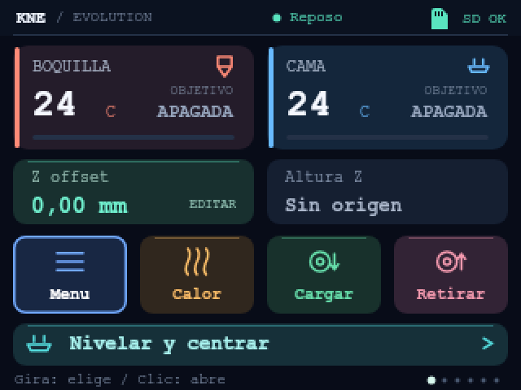
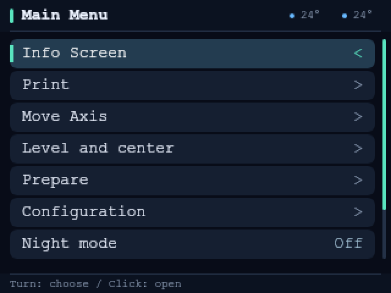
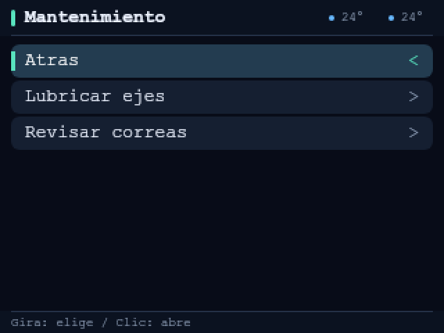
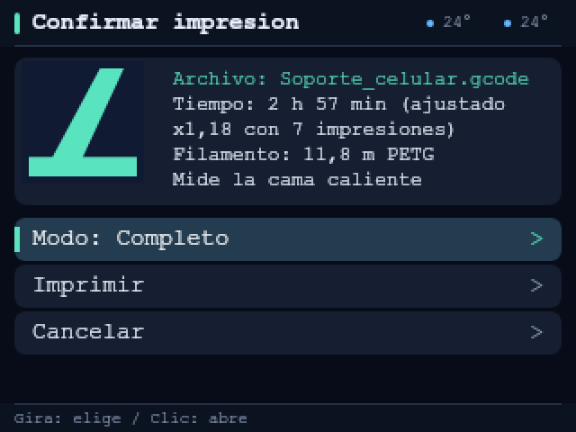

# Kobra Neo Evolution (KNE)

Community firmware for the **original Anycubic Kobra Neo** 3D printer. Current version: **1.0.0**.

Repository: <https://github.com/vdukerios/kobra-neo-evolution>

Kobra Neo Evolution is based on [NuclearPhoenixx/Kobra_Neo](https://github.com/NuclearPhoenixx/Kobra_Neo), which in turn derives from the Marlin 2.0.x source code published by Anycubic. It adds beginner-friendly features (English/Spanish menus, an on-device guide, a one-button "Level and center", two print preparation modes, motor modes and more) on top of that base.

Not affiliated with, endorsed by or sponsored by Anycubic.

## Project status

**Version 1.0.0 is a source release.** An earlier build of this source **booted and ran on the author's Kobra Neo** (November 2026). The latest source in this repository (the audited menus, shared visual design, Home shortcuts, filament workflows and maintenance fixes) has **not been compiled or tested on hardware yet**, so **no firmware binary is attached yet**. The first binary will be published on the Releases page after that build is validated. Each feature still needs validation by more users; see [`testing/TEST_PLAN.md`](testing/TEST_PLAN.md). **Use at your own risk; keep a backup firmware and an SD card with a known-good `firmware.bin`.**

What is confirmed so far (one printer, the author's, November 2026): an earlier build starts, its menus work, and the interface works in English and Spanish. Everything else is **implemented but not yet validated one feature at a time**.

Safety reminders:

- Flashing any firmware can leave a printer unusable, damage it, or create a heat or fire hazard. Never leave the printer unattended during the first prints.
- Keep a hand near the power switch the first times you heat the printer, use "Level and center" or run a print.
- Watch the heaters (nozzle and bed) and check that they switch off when they should.
- **High speed** motor mode drives the X and Y motors at a higher current; check the motors and drivers for heat ([`docs/MOTOR_MODES.md`](docs/MOTOR_MODES.md)).
- Read [`docs/INSTALL.md`](docs/INSTALL.md), [`testing/TEST_PLAN.md`](testing/TEST_PLAN.md) and [`docs/SAFETY_AND_AUDIT.md`](docs/SAFETY_AND_AUDIT.md) before you flash anything.

## Try the screen before you flash

The interface can be explored in your browser with the **[screen simulator](https://vdukerios.github.io/kobra-neo-evolution/)**. It reproduces the 320 x 240 display and the single knob (turn and click; hold the click for help), in English and Spanish, using a preserved menu inventory plus reviewed changes from the current source. It does not execute compiled firmware. Use it to see every menu, the pause menu, the print screens, the maintenance reminders and the new modes.

| Home (Spanish) | Main menu | Maintenance (Spanish) | Confirm print (Spanish) |
|---|---|---|---|
|  |  |  |  |

The simulator is a **source candidate**, not the firmware running: native fonts and layouts are simpler, timings and calibration results are simulated, and a few values show as n/a. If you open `simulator/simulator.html` locally you get the same page. See its *Fidelity notes* panel for what is approximated.

## Latest source update

The [6 November changes](docs/CHANGES_2026-11-06.md) include simplified Configuration, consistent menu cards, additional Home shortcuts, material selection and automatic print preheat after loading, independent maintenance reminders and settings fixes. **88 simulator model cases pass**; all **42 generated screens** are reached by the menu checks. These results do not validate the uncompiled firmware. See [simulator instructions](simulator/README.md) for reproducible checks.

## Features

All of the following are implemented. Their validation status is in [`docs/FEATURES.md`](docs/FEATURES.md).

| Area | Feature |
|---|---|
| Menus | English and Spanish interface (Configuration > Preferences > Language; default English). Spanish texts are plain ASCII, without accents, because the display font does not render them well |
| Menus | On-device guide for beginners (7 topics) and long-press help (hold the knob about 0.8 s on a menu item) |
| Menus | Shared menu styling; Home shortcuts for preheat, loading/unloading, leveling and editable Z offset; print screens with a thumbnail and progress bar |
| Menus | Seven Configuration groups; sound/language preferences; material recipes; SD files sorted alphabetically |
| Printing | Print modes **Full** and **Express** (`M1100` G-code command and a "Confirm print" screen) |
| Printing | "Level and center" button: levels the bed and moves the nozzle to the bed center so you can set the Z offset with a sheet of paper |
| Printing | Junction deviation instead of classic jerk (smoother corners); bed leveling fade height 10 mm |
| Motors | Motor modes: Silent, Mixed, High speed |
| Safety | Heaters switch off after 10 minutes of inactivity (nozzle at 100 C or more, and the bed) |
| Safety | A failed bed mesh cancels the preparation instead of printing blind |
| Maintenance | Print-hours counter with reminders (lubricate axes every 100 h, check belts every 200 h); the reminders follow the interface language |
| Data | Print log on the SD card (`REGISTRO.CSV`) and a learned remaining-time factor (`FACTOR.TXT`) |
| Comfort | Night mode (black screen, silent buzzer, wakes up on errors). The backlight cannot be turned off yet |

Known disabled items: mesh validation pattern (G26) and bilinear subdivision are switched off; power-loss recovery exists but is **off by default** (see [`docs/FEATURES.md`](docs/FEATURES.md)).

## Quick start

1. **Read the project status above** and [`docs/SAFETY_AND_AUDIT.md`](docs/SAFETY_AND_AUDIT.md).
2. **Back up** your current firmware file and your printer settings (`M503`). Keep an SD card with a known-good `firmware.bin`. See [`docs/INSTALL.md`](docs/INSTALL.md).
3. **Get the firmware file.** No binary is attached yet (see *Project status*). Until it is published, build it yourself with Keil MDK and Arm Compiler 5 ([`docs/BUILD.md`](docs/BUILD.md)); the build writes `firmware/workspace/firmware.bin`.
4. **Install it from an SD card**: copy `firmware.bin` to the root of a FAT32 card, insert the card with the printer off, switch the printer on and wait for the home screen. Then switch the printer off, take the card out and delete `firmware.bin` from it. The first boot restores factory settings (see [`docs/INSTALL.md`](docs/INSTALL.md)).
5. **Re-check your settings** (`M503`) and re-measure the bed mesh; set the Z offset with [Level and center](docs/LEVELING_AND_Z_OFFSET.md). Run your own PID tune.
6. **Set up your slicer** ([`docs/CURA_SETUP.md`](docs/CURA_SETUP.md)), print a small test model and report what you see, following [`testing/TEST_PLAN.md`](testing/TEST_PLAN.md).

To build the firmware yourself (Keil MDK with Arm Compiler 5), see [`docs/BUILD.md`](docs/BUILD.md).

## Supported hardware

| Item | Value |
|---|---|
| Printer | Anycubic Kobra Neo (original), 220 x 220 x 250 mm |
| Microcontroller | HC32F460 (Huada Semiconductor) |
| Stepper drivers | TMC2208 (UART) |
| Bed leveling | LeviQ inductive probe |
| Display | 320 x 240 TFT with a single clickable knob (no touch screen) |

Other Anycubic models (Kobra, Kobra Go, Kobra 2, etc.) are **not supported** and the firmware must not be flashed to them.

## Repository layout

| Folder / file | Contents |
|---|---|
| `firmware/` | Firmware source code (Marlin 2.0.x based) and the Keil project (`firmware/workspace/anycubic.uvprojx`) |
| `build/` | Experimental GCC build scripts (they do **not** produce a booting firmware yet; see [`docs/BUILD.md`](docs/BUILD.md)) |
| `cura/` | Cura post-processing scripts, starting-point profiles, start/end G-code |
| `simulator/` | Printer screen simulator source (open `simulator.html` in a browser); `docs/index.html` is the copy served as the live demo |
| `testing/` | Step-by-step hardware test plan and result checklist |
| `releases/` | Release notes (binaries are attached to the GitHub Releases page when they are published) |
| `audit/` | Summary of the safety and boot audits |
| `docs/` | Documentation (below) |
| `NOTICE.md`, `LICENSE` | Credits and third-party licenses; GPL-3.0 |

Documentation index:

| Document | Topic |
|---|---|
| [`docs/INSTALL.md`](docs/INSTALL.md) | Backups, SD installation, first boot, going back |
| [`docs/FEATURES.md`](docs/FEATURES.md) | What every feature does, how to use it, validation status |
| [`docs/MOTOR_MODES.md`](docs/MOTOR_MODES.md) | Silent / Mixed / High speed |
| [`docs/PRINT_MODES.md`](docs/PRINT_MODES.md) | Full / Express and `M1100` |
| [`docs/CURA_SETUP.md`](docs/CURA_SETUP.md) | Scripts, start/end G-code, profiles |
| [`docs/LEVELING_AND_Z_OFFSET.md`](docs/LEVELING_AND_Z_OFFSET.md) | Mesh, Z offset, Level and center |
| [`docs/BUILD.md`](docs/BUILD.md) | Compile it yourself (Keil / Arm Compiler 5) |
| [`docs/TROUBLESHOOTING.md`](docs/TROUBLESHOOTING.md) | Common problems |
| [`docs/ARCHITECTURE.md`](docs/ARCHITECTURE.md) | Feature switches, language tables, file map |
| [`docs/SAFETY_AND_AUDIT.md`](docs/SAFETY_AND_AUDIT.md) | What was audited, fixed and is still unverified |

## Safety disclaimer

3D printers heat parts to 200 C and more and run unattended for hours. This software is provided "AS IS", without warranty of any kind (see the GPL-3.0 text in `LICENSE`). You are solely responsible for what happens to your printer, your property and yourself. The firmware does not remove the thermal protections of the base firmware, but their behavior on this build has not been confirmed one by one on real hardware. Never leave the printer running alone during the first tests.

## Credits

- **Marlin Firmware** (<https://marlinfw.org>), GPL-3.0 or later: the basis of the whole firmware.
- **Anycubic**: Marlin source code adapted to the Kobra Neo, published by the manufacturer under the GPL.
- **NuclearPhoenixx/Kobra_Neo** (<https://github.com/NuclearPhoenixx/Kobra_Neo>): the firmware this project directly derives from, and the reference used to check the Keil build.
- **OrloDavid/HC32F460** (<https://github.com/OrloDavid/HC32F460>): the device pack needed to build with Keil.

Full credits and third-party license notes (including the Huada microcontroller library terms) are in [`NOTICE.md`](NOTICE.md). Backups of other firmware files (Nuclear, Anycubic 1.3.3) are not included; get them from their original repositories.

## License

Distributed under **GPL-3.0** (`LICENSE`).
